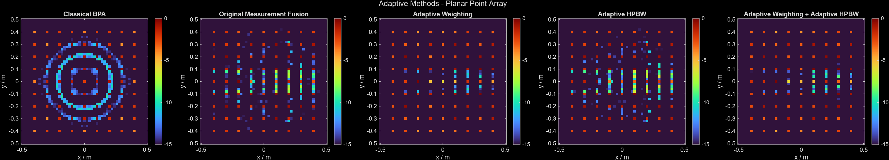
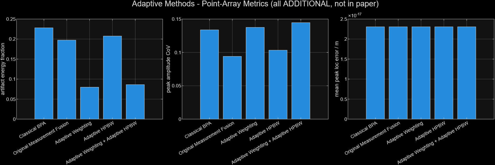
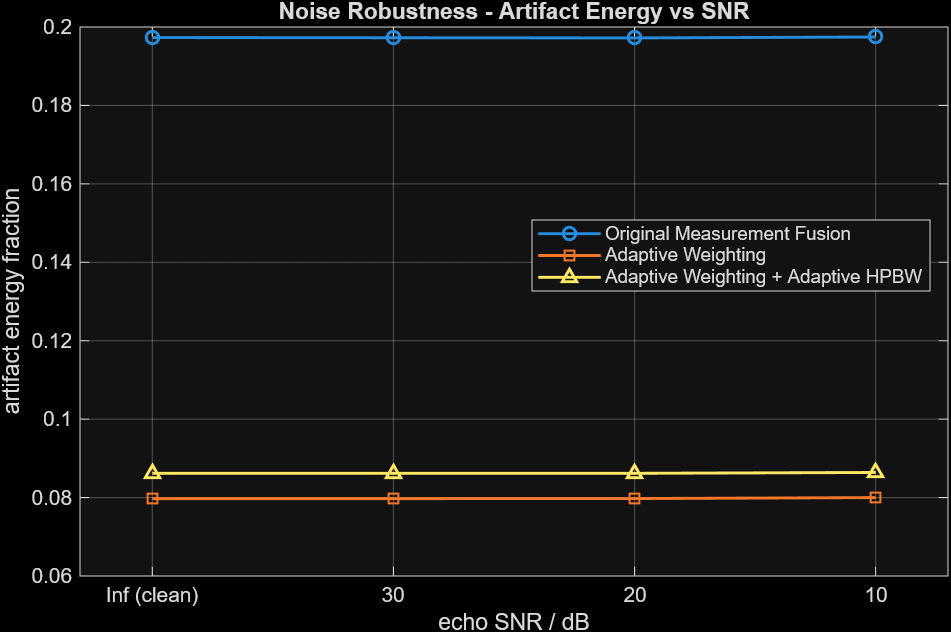
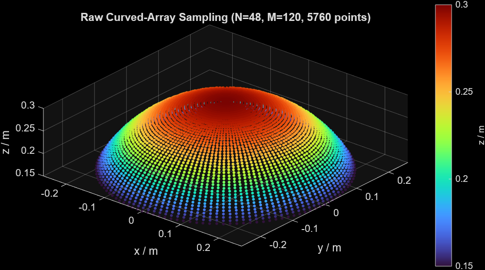
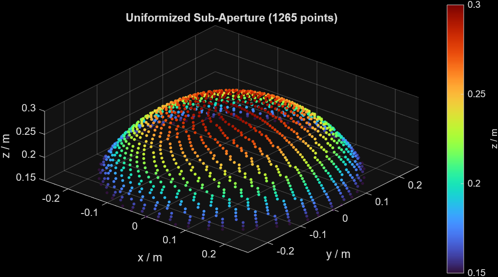
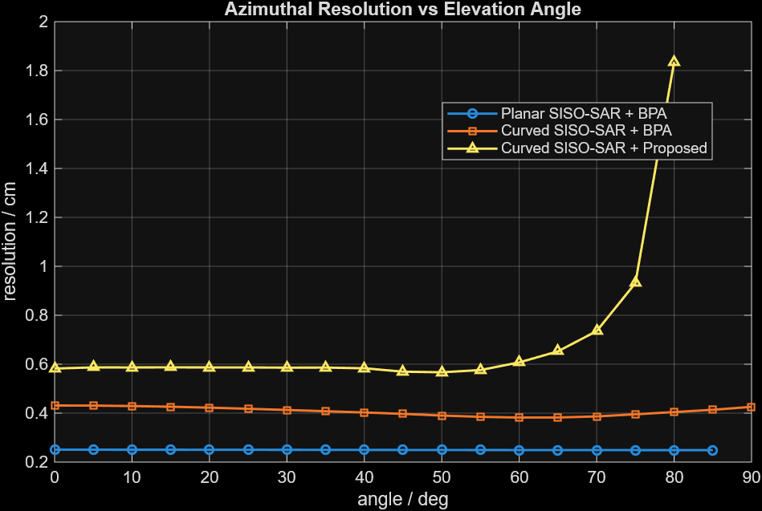
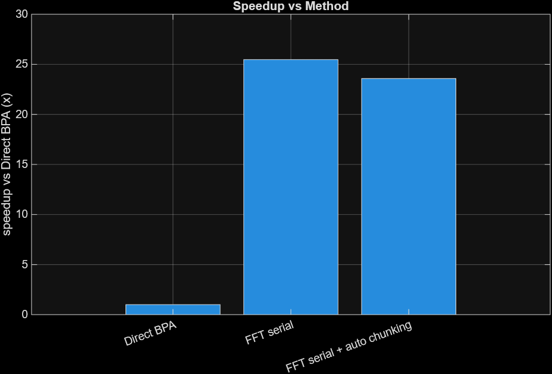
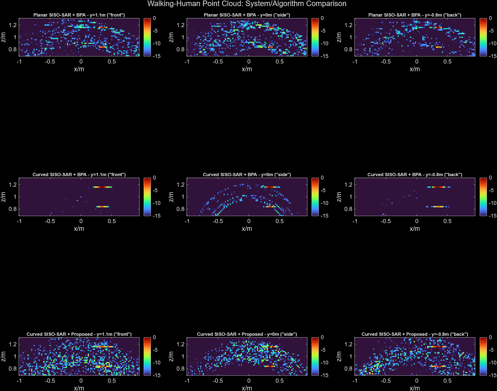

# Wide-FoV Curved SISO-SAR — Reproduction + Adaptive Reconstruction

MATLAB simulation of **millimetre-wave single-input single-output synthetic aperture radar (SISO-SAR)
imaging with a rotating curved linear array**, reproducing

> Wu, Gan & Chen, *"Wide Field-of-View MMW SISO-SAR Image Reconstruction Based on Curved Linear
> Array"*, IEEE Signal Processing Letters, vol. 32, 2025.

and extending it with **adaptive measurement-fusion reconstruction** (our novelty), an optimised
execution framework, and a noise-robustness study.

Course project — Digital Signal Processing (B.Tech ECE, VIT, Fall 2026).



---

## Problem

A planar SAR aperture sees targets well only near broadside; a **curved** aperture rotated about its
axis gives a much wider field of view (useful for e.g. security screening of a walking person). But the
curved geometry samples space very non-uniformly: the centre rings are heavily over-sampled (circular
clutter) while the periphery is sparse. The paper fixes this with *uniform sub-aperture selection*,
an *HPBW beam gate* and a *geometry-based spatial weight*. This project reproduces that pipeline and
asks whether the weight and the gate can be made **adaptive**.

## Paper pipeline (reproduced)

| Step | Paper | File |
|---|---|---|
| Curved rotated aperture | Eq. (3) | `geometry/generateCurvedArray.m` |
| Uniform sub-aperture selection | Eq. (4)–(7) | `reconstruction/createUniformSubAperture.m` |
| Back-projection (BPA) | Eq. (8) | `reconstruction/backProjectionCore.m` |
| Spatial weight `w = 1/count` | Eq. (9) | `reconstruction/calculateSpatialWeights.m` |
| Fixed HPBW gate | Eq. (10), (12) | `reconstruction/calculateHPBWGate.m` |
| Final image `w ⊙ gated BPA` | Eq. (11), (13) | `reconstruction/measurementFusionReconstruction.m` |

Reproduced experiments: sampling distribution (Fig. 4), single point target IPSF, resolution vs
elevation (Fig. 5), planar point array (Fig. 6), walking-human point cloud (Fig. 8).

## Novelty (our contributions — all optional, off by default)

### 1. Adaptive spatial weighting — `computeAdaptiveWeight.m`
The paper's weight depends only on geometry (how many samples illuminate a voxel). We modulate it by a
**bounded, unit-mean confidence factor** from the reconstructed magnitude, so strong coherent
scatterers are kept and low-amplitude clutter/sidelobes are suppressed:

```
confidence = (|img|/max|img| + ε)^α
factor     = clip(confidence, minFactor, maxFactor), normalised to unit mean
w          = (1/count) · factor
```

### 2. Adaptive HPBW gating — `computeAdaptiveHPBW.m`
Instead of one fixed beamwidth, each sample gets an effective HPBW from its elevation: **tighter at
the over-sampled centre** (rejects central clutter), **wider at the sparse periphery** (keeps coverage),
hard-bounded to [45°, 75°]. Geometry-only, so a single pass — no circular dependence on the image.

### 3. Execution framework & benchmark — `applyPerformanceMode.m`, `estimateChunkSize.m`
Unified mode selector (`direct` / `fft_serial` / `fft_parallel` / `fft_gpu` / `fft_auto`),
memory-aware automatic chunk sizing, execution diagnostics, and a reproducible runtime benchmark.
(FFT back-projection, chunking, `parfor` and `gpuArray` existed before; the selector, auto-chunking,
diagnostics and benchmark are ours.)

### 4. Noise robustness — `utils/addComplexAWGN.m`
Complex AWGN SNR sweep (∞, 30, 20, 10 dB) to check that adaptive weighting does not amplify noise.

**Backward compatible:** with default config the reconstruction is numerically identical to the paper
pipeline (`validate_project.m` checks 0.0 relative difference).

Details: [ADAPTIVE_METHODS.md](ADAPTIVE_METHODS.md) · [PERFORMANCE_OPTIMIZATION.md](PERFORMANCE_OPTIMIZATION.md)

---

## Results (quick config)

**Planar point array — artifact energy and contrast**

| Method | Artifact energy fraction ↓ | Peak CoV ↓ | Contrast (dB) ↑ |
|---|---|---|---|
| Classical BPA | 0.228 | 0.134 | 7.83 |
| Original measurement fusion (paper) | 0.197 | **0.094** | 7.70 |
| **Adaptive weighting** | **0.080** | 0.138 | **10.81** |
| Adaptive HPBW | 0.207 | 0.103 | 7.50 |
| Adaptive weighting + adaptive HPBW | 0.086 | 0.145 | 10.61 |

Compared with the paper's method, adaptive weighting cuts out-of-support (artifact) energy by ~60 %
(0.197 → 0.080) and adds ~3 dB contrast. Trade-off:
peak-amplitude uniformity (CoV) gets slightly worse on this coarse grid. Adaptive HPBW alone is close to
neutral in quick mode.

**Runtime (Ns = 5760, Nf = 301, Nv = 343)**

| Method | Runtime | Speed-up | Rel. image error |
|---|---|---|---|
| Direct BPA | 6.96 s | 1× | 0 |
| FFT serial | 0.27 s | **25.5×** | 1.5 × 10⁻² |
| FFT serial + auto chunking | 0.30 s | 23.6× | 1.5 × 10⁻² |

| | |
|---|---|
|  |  |
| Adaptive-method metrics | Artifact energy vs SNR |
|  |  |
| Raw curved-aperture sampling | After uniform sub-aperture selection |
|  |  |
| Azimuth resolution vs elevation | FFT / chunking speed-up |

**Walking-human point cloud: planar vs curved, BPA vs proposed**



---

## Quick start

Requirements: MATLAB (base product). Optional: Parallel Computing Toolbox (for `fft_parallel` /
`fft_gpu`).

```matlab
cd 'path/to/this/repo'
addpath(genpath(pwd))

validate_project          % automated check suite (quick config, < 1 min)
main                      % interactive menu of all experiments
```

Configuration:

```matlab
cfg = config('quick');    % small/fast — demos & tests
cfg = config('full');     % paper-scale parameters (slow: hours)
```

Every `config()` call creates a timestamped folder `results/run_<timestamp>/`; all figures and `.mat`
data for that run go there (not committed to git — regenerate by running).

### Reproduce everything

```matlab
cfg = config('quick');
% paper experiments
experimentSampling(cfg);  experimentPointTarget(cfg);  experimentResolution(cfg);
experimentPointArray(cfg); experimentHuman(cfg);
% our extensions
experimentAdaptiveMethods(cfg); experimentRuntimeBenchmark(cfg); experimentNoiseRobustness(cfg);
validate_project;
```

### Switching modes

```matlab
cfg.weighting.mode   = 'adaptive';   % 'original' (paper) | 'adaptive'
cfg.gating.mode      = 'adaptive';   % 'fixed' (paper)    | 'adaptive'
cfg.noise.enable     = true;  cfg.noise.SNR_dB = 20;
cfg.performance.mode = 'fft_auto';   % direct | fft_serial | fft_parallel | fft_gpu | fft_auto
```

---

## Repository structure

```
├── main.m                  interactive experiment menu
├── config.m                all parameters (paper / implementation / our extensions)
├── validate_project.m      automated validation suite
├── geometry/               curved & planar array generation
├── signal/                 echo models (point target, scene, human point cloud), antenna gain
├── targets/                point target, point array, human point cloud
├── reconstruction/         BPA, sub-aperture selection, gate, weights, adaptive methods, perf modes
├── experiments/            one script per figure / study
├── utils/                  AWGN, metrics (resolution, sidelobe, uniformity, artifact energy), dB
├── visualization/          2-D/3-D image and comparison plots
├── docs/images/            figures used in this README
├── ADAPTIVE_METHODS.md     novelty: formulas, parameters, stability, results
└── PERFORMANCE_OPTIMIZATION.md   execution modes, chunking, benchmark
```

## Limitations

- Adaptive weighting is a bounded heuristic, not a derived optimum (ML / iterative reweighting is a
  natural next step).
- Adaptive gating uses elevation only; azimuth sampling density is not yet used.
- Quick mode is deliberately under-sampled; some effects only show at `config('full')`.
- Simulation only — no measured radar data. Nothing here is claimed to be in, or endorsed by, the
  original paper.

## Reference

Wu, Gan & Chen, "Wide Field-of-View MMW SISO-SAR Image Reconstruction Based on Curved Linear Array,"
*IEEE Signal Processing Letters*, vol. 32, 2025. The paper PDF is not included (copyright).

## Author

M Hari Shankar — B.Tech ECE, VIT
